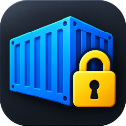
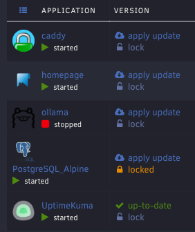
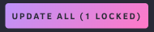
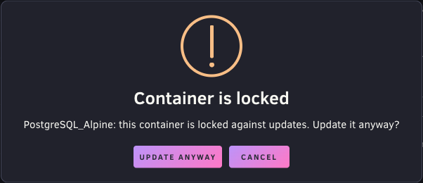

# Docker Locker for Unraid



[](https://github.com/chemicalsno/unraid-docker-locker/actions/workflows/test.yml)
[](LICENSE)
[](#requirements)

Lock the Docker containers you don't want updated, then use **Update All** for everything else.

Docker Locker adds a lock toggle to every container on the **Docker** page. **Update All** skips locked containers, and updating a locked container on its own asks you to confirm first. You don't need to pin image tags or pick containers from a list every time.



## Contents

- [Features](#features)
- [Requirements](#requirements)
- [Install](#install)
- [Use](#use)
- [What locks don't cover](#what-locks-dont-cover)
- [Uninstall](#uninstall)
- [Troubleshooting](#troubleshooting)
- [FAQ](#faq)
- [How it works](#how-it-works)
- [Development](#development)
- [Changelog](#changelog)
- [License](#license)

## Features

- **Lock toggle on every container.** Locked containers show an orange **locked** label in the update column. Unlocked containers show a grey **lock** link.
- **Update All skips locked containers.** The button shows how many containers it skips, for example **Update All (2 locked)**.
- **Single updates ask first.** If you update a locked container from its **apply update** link, from the right-click menu on the **Docker** page, or from the container menu on the **Dashboard**, a warning asks you to confirm.
- **Locks stay current across browser tabs.** Before any update, the plugin reads the lock list from the server, so a lock that you set in another tab still applies.
- **Locks persist.** Locks are stored on the flash drive and survive reboots, plugin updates, and reinstalls.
- **Fails closed.** If a future Unraid release changes the code that the plugin depends on, the plugin stops modifying **Update All** and disables it while any container is locked. If the **Docker** page changes so much that the plugin can't attach to it, a warning banner says that locks may not apply.



## Requirements

- Unraid 7.3.0 or later. The plugin was tested on Unraid 7.3.3.
- Containers managed by Unraid's Docker page (containers created from an Unraid template). Unraid's own update routine can't update Docker Compose containers, so locks have no effect on them.

## Install

### From a URL

1. In the Unraid web UI, go to **Plugins > Install Plugin**.
2. Paste the following URL and click **Install**:

   ```text
   https://raw.githubusercontent.com/chemicalsno/unraid-docker-locker/main/docker.locker.plg
   ```

3. Reload the **Docker** page.

### From a file

1. Copy `docker.locker.plg` to the flash drive, for example to `\\tower\flash\docker.locker.plg`.
2. Install it in one of these ways:
   - In the web UI, go to **Plugins > Install Plugin**, enter `/boot/docker.locker.plg`, and click **Install**.
   - In the Unraid terminal, run:

     ```bash
     plugin install /boot/docker.locker.plg
     ```

3. Reload the **Docker** page.

The installer copies the plugin file to `/boot/config/plugins/`, so Unraid reinstalls the plugin at every boot.

## Use

### Lock a container

1. Go to **Docker > Docker Containers**.
2. In the container's update column, click **lock**.

The label changes to an orange **locked**. To unlock the container, click **locked**.

### Update everything except locked containers

Click **Update All** at the bottom of the **Docker** page. The update window title shows how many containers were skipped, for example **Updating all Containers (2 locked)**.

If every container with a pending update is locked, **Update All** is disabled.

### Update a locked container anyway

If you click **apply update** on a locked container, or select **Update** from its menu on the **Docker** page or the **Dashboard**, the following warning appears:



To update the container, click **Update anyway**. The container stays locked afterward.

## What locks don't cover

Locks apply only to updates that you start from the **Docker** page or the **Dashboard** in the web UI. The following update paths ignore locks:

- The CA Auto Update Applications plugin.
- The Appdata Backup plugin's option to update containers after a backup.
- Unraid Management Agent and other tools that update containers through an API.
- Compose Manager and other Docker Compose tools.
- The `update_container` script run from the terminal.
- `docker pull` followed by recreating a container by hand.

Locks also don't hide Unraid's **update ready** status or its update notifications for locked containers.

## Uninstall

Use one of these methods:

- In the web UI, go to **Plugins > Installed Plugins** and remove **docker.locker**.
- In the Unraid terminal, run:

  ```bash
  plugin remove docker.locker.plg
  ```

Uninstalling removes the plugin's web UI files. It keeps the lock list at `/boot/config/plugins/docker.locker/locked.json`, so reinstalling restores your locks. To delete the lock list too, run:

```bash
rm -r /boot/config/plugins/docker.locker
```

## Troubleshooting

### The lock toggles don't appear

1. Reload the **Docker** page to load the plugin's script.
2. Check that the plugin is installed:

   ```bash
   ls /usr/local/emhttp/plugins/docker.locker
   ```

   The output lists `DockerLocker.page`, `include`, and `javascript`.
3. Open your browser's developer console on the **Docker** page and look for errors that mention `lock.js`.

### Update All is disabled and shows a warning

If you hover over **Update All** and see "Docker Locker does not support this Unraid version", your Unraid release changed the code that the plugin depends on. The plugin disables **Update All** while any container is locked so that it can't update a locked container. To use **Update All**, unlock all containers or check for a plugin update.

### A banner says Docker Locker doesn't support this version of Unraid

The banner appears on the **Docker** page when containers are locked but the plugin couldn't attach to the page, which happens if an Unraid release redesigns it. Locks might not apply from that page, so check each container before you update it, or check for a plugin update. The banner can't be dismissed. It goes away when you unlock all containers or install a version of the plugin that supports your Unraid release.

### "Unable to read the lock list. Nothing was updated."

The plugin couldn't reach its lock endpoint before an update, so it stopped the update. Reload the page and try again. If the error continues, check that the following file exists:

```text
/usr/local/emhttp/plugins/docker.locker/include/Lock.php
```

### A renamed container lost its lock

Locks are stored by container name. If you rename a container, lock it again under its new name. The old name stays in the lock list but has no effect.

## FAQ

### Why not pin image tags instead?

Pinning a tag, such as `postgres:16.4` instead of `postgres:latest`, changes which image the container runs. A lock leaves the container's configuration alone and only keeps **Update All** away from it. You can unlock the container at any time and update to whatever its current tag points to.

### How is this different from CA Auto Update Applications?

CA Auto Update Applications updates containers on a schedule, and you select which containers it updates. Docker Locker works the other way around: you select which containers to skip, and you keep updating by hand with **Update All**. The two plugins don't share settings, so CA Auto Update Applications doesn't know about your locks.

### Does a lock stop a container from starting or restarting?

No. A lock only affects updates.

## How it works

The `.plg` file contains everything the plugin installs:

- `DockerLocker.page` is a `Menu="Buttons"` page. Unraid evaluates these pages in the head of every web UI page. The page outputs the lock list and loads `lock.js`.
- `javascript/lock.js` replaces Unraid's `updateAll()` and `updateContainer()` functions from `dynamix.docker.manager/javascript/docker.js`. Before replacing them, it checks that they still match the Unraid 7.3 versions. It adds the lock toggles after each container list load by listening for jQuery's `ajaxSuccess` event on the `DockerContainers.php` request.
- `include/Lock.php` reads and writes the lock list at `/boot/config/plugins/docker.locker/locked.json`. It accepts only names that match Docker's container name rules, and it writes to a temporary file first so that a power loss can't leave a partly written list. The web UI's sign-in and CSRF protection cover the endpoint like any other plugin page.

## Development

The tests run `lock.js` from the `.plg` file in [jsdom](https://github.com/jsdom/jsdom) against `test/fixtures/docker.js`, an unmodified copy of `docker.js` from the `7.3` branch of [unraid/webgui](https://github.com/unraid/webgui).

```bash
cd test
npm install
npm test
```

To check the plugin against a different Unraid release, point `DOCKER_JS` at that release's `docker.js`:

```bash
DOCKER_JS=/path/to/docker.js npm test
```

GitHub Actions runs the tests, checks that the `.plg` is well-formed XML, and checks the PHP syntax on every push and pull request. Once a week, it also runs the tests against `docker.js` from the `master` branch of unraid/webgui, so a breaking change shows up before it reaches a stable Unraid release.

Before you install a changed `.plg` file on a server, increase the `version` entity at the top of the file. The Unraid plugin installer skips a reinstall when the version doesn't change, unless you run `plugin install <file> forced`.

## Changelog

See the `<CHANGES>` section of [`docker.locker.plg`](docker.locker.plg). The **Installed Plugins** page shows the same changelog.

## License

Docker Locker is licensed under the [GNU General Public License v2.0](LICENSE).

`test/fixtures/docker.js` is an unmodified copy from the `7.3` branch of [unraid/webgui](https://github.com/unraid/webgui). The file has no license header of its own. Other files in that repository, such as `DockerContainers.page`, carry a Lime Technology copyright and a GPL-2.0 notice.
